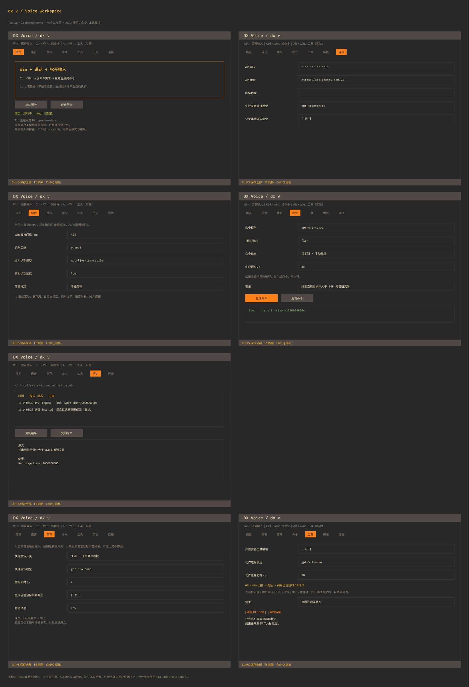

# DX Voice

**Win → dictate. Ctrl+Win → a shell command. `dx v` → settings and history.**

Streaming voice input for Linux, standalone or as a [Dex](https://github.com/soul667/Dex) plugin. The terminal workspace is assembled from [Textual](https://textual.textualize.io/) widgets and the existing DX theme engine. Models are called through the official OpenAI SDK; local records use SQLite.

[Editable Figma workspace](https://www.figma.com/design/dTUUsl2mSeFExFV2VFQa6k?node-id=17-110) · [Product/reuse review](docs/product-review.md) · [Component library](design/README.md)



## What runs

- **Hold Win for about 0.4 seconds:** live dictation. Release to insert the final text into the original input field. No Enter is sent.
- **Hold Ctrl+Win for about 0.4 seconds:** dictate a command request. Terra returns only a command. It is copied by default, ready for manual paste. The app never runs it.
- **`dx v`:** terminal Overview, Voice, Rewrite, Command, Tools, History and Connection tabs. All settings are centralized here. The optional TXT file remains the underlying private configuration, not a separate GUI settings page.
- **Optional light cleanup:** remove verbal fillers/repetition and improve punctuation with a small model. Raw, fast dictation is the default; cleanup can add model latency. Timeouts preserve the original text.
- **Opt-in screen context:** independently enable screenshot context in Rewrite. At release, only the monitor containing the mouse pointer is captured, resized and sent to the rewrite model. Images stay in RAM and are not recorded in history. Both rewrite and screenshot switches must be on.
- **Hold Alt+Win for about 0.4 seconds:** experimental registered DX actions: local status queries and opening explicit documents/directories/URLs. Uses existing DX Tools; this executes registered actions, independently of command generation.
- **Vocabulary and history:** recognition hints for names/technical terms; original/result records and re-copy actions in one local file.

Ctrl alone does not start dictation. Mouse-button/wheel activity and unrelated chords suppress Win dictation until Win is released. Only action buttons catch mouse input; the rest of the floating HUD lets clicks/scroll through. The original GNOME Super overview setting is saved while the service runs and restored when it stops; other Super shortcuts remain available.

The HUD implements the Figma voice pill and transcript card, with light/dark/frosted treatments and original exported SVGs. Terminal colors follow `dx tui.engine` when available; terminal fonts remain controlled by the terminal. No new theme picker is introduced here.

## Install

Supported: GNOME/X11 Linux, PulseAudio or PipeWire's PulseAudio service, Python 3.10–3.12. Wayland/macOS/Windows support is not implemented. An API key with realtime transcription and Responses access is required; a chat-only compatible endpoint is insufficient.

```bash
sudo apt install python3-venv python3-gi python3-cairo python3-gi-cairo \
  gir1.2-gtk-3.0 gir1.2-pango-1.0 gir1.2-rsvg-2.0 pulseaudio-utils xdotool xclip x11-utils
# Optional tray icon:
sudo apt install gir1.2-ayatanaappindicator3-0.1

git clone https://github.com/soul667/dx-voice.git
cd dx-voice
python3 -m venv --system-site-packages .venv
.venv/bin/pip install -e .
.venv/bin/dx-voice setup
.venv/bin/dx-voice tui
```

Enter your key in Connection, save with Ctrl+S, then start the service from Overview. Inter and Noto Sans SC provide the floating UI's reference typography. The Textual UI uses your terminal's font and respects its color capabilities.

## Dex integration

```bash
dx plugin install /absolute/path/to/dx-voice --enable
# Run once from the Python environment containing the dependencies:
.venv/bin/dx-voice setup
dx v
```

From a Dex checkout: `git submodule update --init plugins/voice`, then `dx plugin install builtin:voice --enable`. The plugin is an independent Git submodule at `plugins/voice`.

`dx v` and `dx voice` use the same implementation. The lightweight adapter can load under a newer Dex host Python; the audio process uses the interpreter recorded by setup. `DX_VOICE_PYTHON` can override that interpreter explicitly. Installing/enabling the CLI plugin alone does not start a microphone, make model calls or install missing dependencies.

## Settings

`dx v` is the primary interface. Every field from [settings.example.txt](settings.example.txt) is represented there. Save with Ctrl+S; changes apply to the next turn. `dx v settings --file` opens the underlying `~/.config/dx-voice/settings.txt` when direct editing is needed.

Important controls:

| Field | Meaning |
| --- | --- |
| `hotkey_hold_ms` | Hold threshold; default 400 ms |
| `cleanup_mode` | `none` fastest, or `light` optional cleanup |
| `cleanup_model` | Defaults to `gpt-5.4-nano` |
| `command_model` | Defaults to `gpt-6.1-terra` |
| `command_shell` | Target bash/fish/zsh/sh; defaults to a supported login shell |
| `command_output` | `clipboard` default, or `paste` into the original field; neither sends Enter |
| `vocabulary` | Comma-separated recognition hints |
| `history_enabled` | Local history on/off; on by default |
| `proxy_url` | Proxy used by the user service, if required |
| `theme` | Floating HUD frosted/light/dark/auto; terminal theme stays with DX |

Credentials stay in the private user config. A normal speech turn streams audio to the configured realtime endpoint. Cleanup and command mode additionally send the transcript/request to the chosen text model. Idle preconnection does not open the microphone.

## Local history and recovery

The single record file is `~/.local/state/dx-voice/history.db` (0600, parent directory 0700). Each turn records its time, mode, original, final output and outcome, rather than verbose debug traces. The History tab displays the latest 100 rows and can copy either original or result. Older rows are not automatically discarded. Cancelled turns retain status metadata, not interim speech.

Successful audio is deleted; failed audio stays in the private state directory for explicit retry. API keys, recordings and history are never part of the public repository. `last-transcript.txt` remains a small latest-result fallback.

```bash
dx v status
dx v history --path
dx v history --limit 5
dx v command 'Find regular files larger than 1 GB under the current directory'
dx v stop
dx v start
dx v retry
```

`dx v command` prints the command alone; no generated shell command is executed. Syntax checking uses the target shell's parse-only mode with user startup config disabled where supported. Invalid/multiline/model-error output is not pasted as a command.

## Development and scope

```bash
PYTHONPATH=src .venv/bin/python -m unittest discover -s tests -v
```

Tests use temporary private files, a loopback WebSocket fixture and Textual's headless pilot. They make no paid model calls. Coverage includes key-chord mode selection/release order, mouse precedence, settings masking/save validation, private history, copying commands without execution, model-failure fallback, connection reuse and target-window protection.

The [product review](docs/product-review.md) compares Handy, OpenWhispr, VoiceInk and the commercial Wispr Flow experience, and separates shipped functionality from future work. Todo extraction and agent dispatch are future work, not hidden side effects of dictation.

A prior synthetic realtime test inserted text about 0.94 seconds after release. Separate synthetic probes returned cleanup in about 2.8 seconds and a simple Terra command in about 3.6 seconds. These are examples, not human-speech accuracy or latency guarantees.

MIT. Dependencies retain their own licenses.

## Module boundaries

`modules/asr.py` defines the speech backend factory. OpenAI is the only bundled provider; installed adapters can register the `dx_voice.asr` entry-point group. Qwen is not bundled or verified yet. ASR and text-model connection overrides are independent. `rewrite.py`, `command.py` and `tools.py` own their separate workflows.

The frosted HUD uses MSS + Pillow to blur a small local background snapshot when it appears, with an alpha tint. It is not continuously refreshed compositor blur. This local visual effect does not upload background pixels; model screenshot context has its own default-off switch.

`dx v modules`, `dx v asr providers` and `dx v tools list` show supported modules/providers/actions. Arbitrary shell execution, agent dispatch and todo extraction are not implemented.
