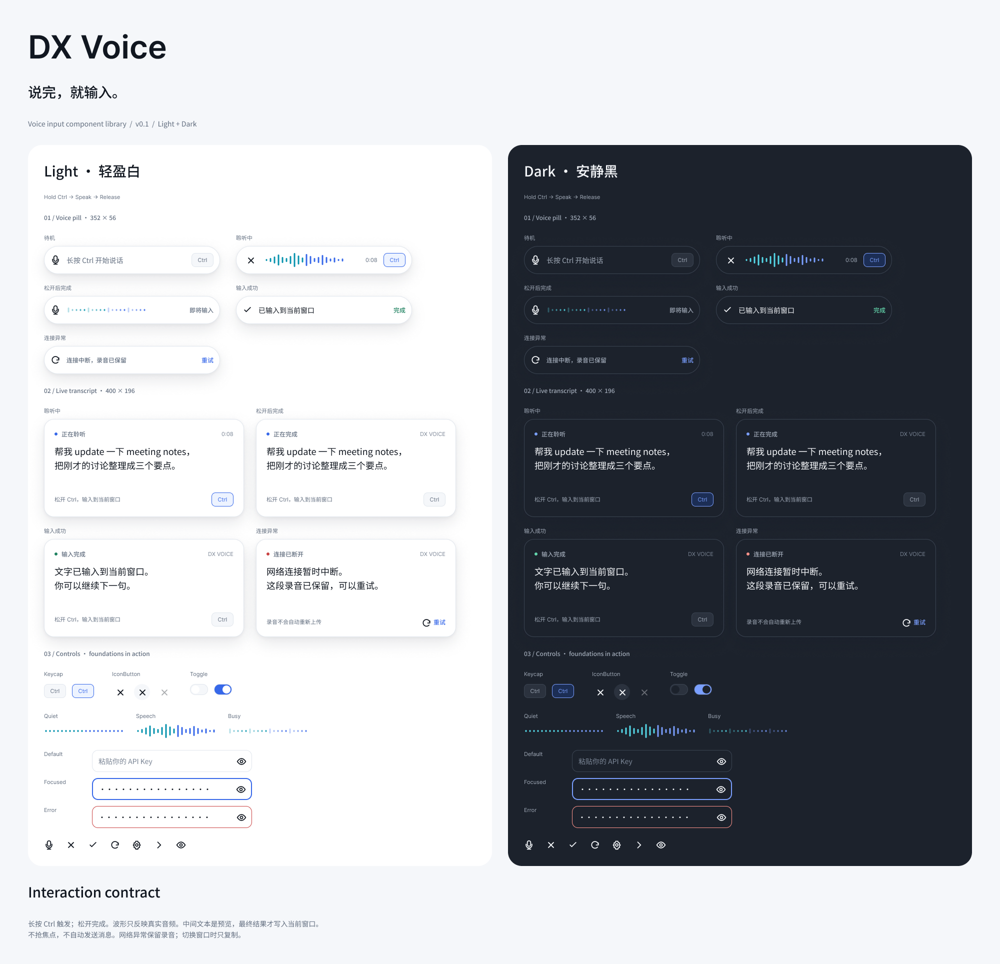
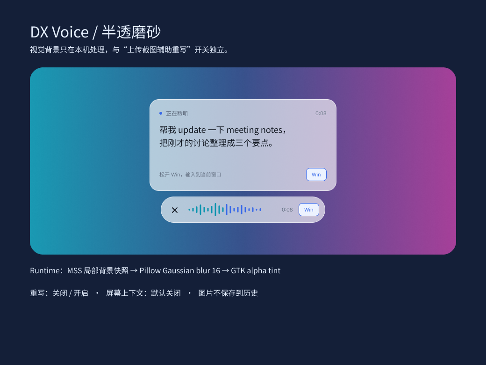

# DX Voice component library

[Open Figma](https://www.figma.com/design/dTUUsl2mSeFExFV2VFQa6k?node-id=10-2) · [State gallery](https://www.figma.com/design/dTUUsl2mSeFExFV2VFQa6k?node-id=8-2)

This is an editable native Figma library, not a set of flattened screenshots. Access follows the file's Figma team permissions. The exported previews below are included in the public source repository.

## File structure

- **00 · DX Voice:** cover, product language, interaction principles and handoff.
- **01 · Foundations:** 51 primitive/semantic/metric variables, Light/Dark modes, six shared text styles, floating shadow.
- **02 · Components:** main components and variant sets.
- **03 · States:** 58 instances showing every component state in both themes.

Main components stay on the component page. Change `State`, `Activity` or `Value` on an instance; change the Color collection mode to switch theme. Keycap text, transcript text, helper visibility, and the IconButton icon are exposed component properties.

## Inventory

| Component | Variants | Intended role |
| --- | --- | --- |
| VoicePill | Idle, Listening, Finishing, Success, Error | Compact 352 × 56 dictation strip |
| TranscriptCard | Listening, Finishing, Success, Error | Expanded 400 × 196 live preview |
| Waveform | Quiet, Speech, Busy | PCM-driven amplitude history and explicit processing state |
| Keycap | Default, Held | Keyboard affordance; editable text |
| IconButton | Default, Hover, Disabled | Instance-swappable action icon |
| TextField | Default, Focused, Error | API/configuration inputs |
| Toggle | Off, On | Settings control |

Seven 20 px icons: Mic, Close, Check, Retry, Settings, Chevron, Eye. Component IDs, variant IDs and token IDs are in [component-map.json](component-map.json).

## Design direction

The lightweight surfaces, blue–cyan voice feedback and clear end-of-turn states reference [Doubao Input's official product material](https://ime.doubao.com/pc). The small desktop footprint and straightforward gesture reference [Handy](https://github.com/cjpais/Handy). Components, icon geometry and DX Voice identity are independent editable assets; no third-party screenshots or logos are packaged.

Typography uses Noto Sans SC for Chinese and mixed text, with Inter for Latin display/numeric labels. Downloadable fonts are not bundled. Semantic colors alias primitives; spacing, radii, fills and borders are variable-bound. [tokens.json](tokens.json) and [tokens.css](tokens.css) are the implementation handoff names, including `var(--dx-voice-...)` syntax.

Main text contrast against panels is at least 5.25:1 in the reviewed roles. Light accent text is 4.86:1, and the light waveform start color is 3.62:1 against white. Disabled controls and nonessential captions intentionally use reduced emphasis; these figures are targeted checks, not a certification of every possible combination.

## Interaction and motion

1. **Idle → Listening:** hold Win for roughly 400 ms (Ctrl+Win selects command mode). Do not take focus from the current input field.
2. **Listening:** open microphone only for the active turn. Drive waveform amplitude from actual PCM, and display real incremental transcripts. No decorative loop may masquerade as audio feedback.
3. **Listening → Finishing:** release Win, drain captured tail frames, then commit the live audio turn. Preserve the preview while awaiting final text.
4. **Finishing → Success:** paste the final result once; never press Enter. If the active window changed, copy instead and use a copied-result message.
5. **Error:** retain the recording locally. Retry must be explicit, since it uploads audio again.
6. **Cancel:** another key or mouse action during a Ctrl-held turn cancels; do not insert stale partial results.

Motion target: 120–160 ms surface appearance, 80–120 ms amplitude smoothing, and a short confirmation followed by fade. Reduced-motion mode should keep state changes and replace nonessential movement with static feedback. These are design specs; native Figma state variants do not simulate the speech API.

## Implementation boundary

The v0.2 GTK runtime implements `VoicePill`, `TranscriptCard`, `Waveform`, `Keycap` and the cancel/retry actions in `VoiceOverlay`. It uses packaged semantic tokens, Inter/Noto Sans SC typography, and the original exported light/dark SVG assets. Live text expands the card above the pill; releasing Win finalizes and inserts text. Settings use Textual widgets in `dx v`; no separate GUI settings window is planned.

Figma Code Connect does not provide a GTK/Python target, so no Code Connect integration is claimed. The documented component map is the handoff until the production UI is implemented.

## Previews

## Terminal workspace v0.4

[Open the editable terminal page](https://www.figma.com/design/dTUUsl2mSeFExFV2VFQa6k?node-id=17-110). Seven native, editable views mirror the Textual Overview, Voice, Rewrite, Command, Tools, History and Connection tabs. Repeated fields/buttons are component instances. Colors reference DX's shared Gruvbox theme, rather than a new picker. Fira Code/Noto Sans SC are design-reference fonts; the actual terminal chooses its font. The original library remains the floating HUD source, with its editable keycap label configured as Win.

## Frosted material

[Editable material preview](https://www.figma.com/design/dTUUsl2mSeFExFV2VFQa6k?node-id=21-148) reuses the original HUD component instances over an editable procedural gradient. Runtime uses a local background snapshot, Gaussian blur 16, 0.80 backdrop alpha, 0.64 white tint and 0.62 border alpha. It is separate from opt-in screenshot upload for rewrite.

